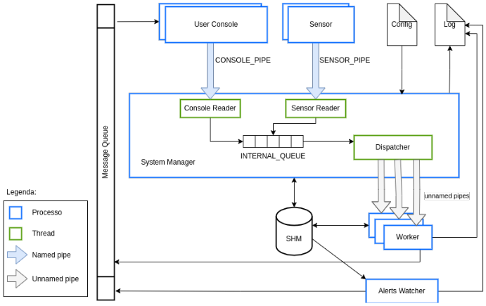

# Home Internet of Things Simulator

## Index
- [Project Overview](#project-overview)
- [Project Requirements](#project-requirements)
- [Implementation](#implementation)
- [Repository Structure](#repository-structure)
- [Usage Instructions](#usage-instructions)

## Project Overview

This academic project simulates a Internet of Things (IoT) environment in which multiple sensors send readings to a central system, which stores the collected data, generates statistics, and triggers alerts when predefined conditions are met.


- **Course**: Operating Systems.
- **Technologies**: C. 
- **Concepts**: Processes, threads, shared memory, pipes, semaphores.

The project architecture is presented and detailed below.



### Processes and Threads

- **Sensor** – A process that periodically generates data and sends it to the System Manager through a named pipe. Multiple Sensor processes can run simultaneously.
- **User Console** – A process that interacts with the user and communicates with the System Manager through a named pipe to send commands. It allows users to manage the system, retrieve statistics and other information, and receive real-time alerts. Responses and alerts are received through the Message Queue. Multiple User Console processes can run simultaneously.
- **System Manager** – The process responsible for starting the system, reading the configuration file, and creating the Worker processes and the Alerts Watcher process.
- **Worker** – A process responsible for handling requests received from Sensor and User Console processes. Multiple Worker processes can run simultaneously.
- **Alerts Watcher** – A process responsible for monitoring sensor values and checking whether they exceed the configured limits. When a limit is exceeded, it sends an alert through the Message Queue to the corresponding User Console processes that have subscribed to that alert.
- **Console Reader** – A thread that reads commands sent by User Console processes through the `CONSOLE_PIPE` named pipe.
- **Sensor Reader** – A thread that reads data sent by Sensor processes through the `SENSOR_PIPE` named pipe.
- **Dispatcher** – A thread that retrieves requests stored in the `INTERNAL_QUEUE` and forwards them through unnamed pipes to an available Worker process.

### Inter-Process Communication (IPC)

- **`SENSOR_PIPE` (Named Pipe)** – Allows Sensor processes to send data to the System Manager process.
- **`CONSOLE_PIPE` (Named Pipe)** – Used by User Console processes to send commands to the System Manager process.
- **Shared Memory (SHM)** – A shared memory region accessed by the System Manager, Worker, and Alerts Watcher processes.
- **Unnamed Pipes** – Enable communication between the System Manager process and each Worker process.
- **Message Queue** – Used by the Alerts Watcher to send alert messages to User Console processes, and by the Workers to send responses to User Console requests.


## Project Requirements
### User Console
- Creation of the User Console process.
- Correct parsing of command-line arguments and user commands.
- Generation of tasks and writing them to the `CONSOLE_PIPE` named pipe.

### Sensor
- Creation of the Sensor process.
- Correct parsing of command-line arguments.
- Generation of tasks and writing them to the `CONSOLE_PIPE` named pipe.

### System Manager
- System startup, configuration file reading, data validation, and application of the loaded configuration.
- Creation of shared memory.
- Creation of the `SENSOR_PIPE` and `CONSOLE_PIPE` named pipes.
- Creation of the Worker processes.
- Creation of the Alerts Watcher process.
- Creation of threads.
- Creation of the message queue.
- Handling of the `SIGINT` signal, system termination, and resource cleanup.

### Alerts Watcher
- Alert management.
- Sending alerts to User Console processes through the message queue.

### Worker
- Reading tasks from the unnamed pipe.
- Executing tasks.

### Log File
- Synchronized output to the log file and terminal.

### General
- Creation of a Makefile.
- Architecture diagram illustrating the system and synchronization mechanisms.
- Support for concurrent request processing.
- Error detection and handling.
- Updating shared memory (SHM) by all processes and threads that require it.
- Synchronization using appropriate mechanisms (semaphores, mutexes, or condition variables).
- Prevention of unwanted interruptions by signals not specified in the assignment, and appropriate handling of the signals specified in the assignment.
- Controlled termination of all processes and threads, and release of all resources upon receiving `SIGINT`.

## Implementation

Semaphores were used to manage the availability of Worker processes and synchronize access to shared memory, terminal and log output, and sensor statistics. A mutex was used to protect the internal request queue against concurrent access by multiple threads. Condition variables were also used to coordinate queue operations, allowing threads to wait when the queue is full or empty without busy waiting.

## Repository Structure

``` text
.
├── .gitignore
├── README.md
├── config_file.txt
├── docs
│   ├── arch.png
│   └── assignment.pdf
├── makefile
├── sensor.c
├── shared_functions.c
├── shared_functions.h
├── system_manager.c
└── user_console.c
```

## Usage Instructions

### Build

Compile the project using the provided Makefile:

```bash
make
```

Ensure that the generated executables have execution permissions. If necessary, grant them using:

```bash
chmod +x home_iot sensor user_console
```

The application must also have sufficient permissions to create and access the required IPC resources, including named pipes, shared memory, and message queues.

### Run

1. **Start the System Manager**, providing the path to the configuration file:
   ```bash
   ./home_iot <config_file>
   ```
   Example:
   ```bash
   ./home_iot config.txt
   ```

2. **Start one or more Sensor processes**, specifying a sensor ID, sampling interval (seconds), data key, and minimum and maximum values:
   ```bash
   ./sensor <sensor_id> <interval> <key> <min_value> <max_value>
   ```
   Example:
   ```bash
   ./sensor SENS1 3 ROOM_TEMP 10 100
   ```

3. **Start one or more User Console processes**, each with a unique console ID:
   ```bash
   ./user_console <console_id>
   ```
   Example:
   ```bash
   ./user_console 1
   ```

### User Console Commands

Once a User Console is running, the following commands are available:

| Command | Description |
|---|---|
| `stats` | Displays sensor statistics, including the latest, minimum, maximum and average values, and the number of readings. |
| `sensors` | Lists all sensors that have sent data to the system. |
| `reset` | Resets all collected statistics. |
| `add_alert [id] [key] [min] [max]` | Adds an alert rule for a specified data key and acceptable value range. |
| `remove_alert [id]` | Removes an existing alert rule. |
| `list_alerts` | Lists all registered alert rules. |
| `exit` | Terminates the User Console. |

### Configuration

The configuration file must contain five values, one per line, in the following order:

```text
QUEUE_SZ
N_WORKERS
MAX_KEYS
MAX_SENSORS
MAX_ALERTS
```

These define the internal queue capacity, number of Worker processes, maximum number of stored data keys, maximum number of registered sensors, and maximum number of active alerts, respectively.

Example configuration:

```text
10
5
300
10
50
```

### Signals

- **SIGINT (`Ctrl+C`)** – Initiates a controlled shutdown when sent to the System Manager, or terminates an individual Sensor or User Console process.
- **SIGTSTP (`Ctrl+Z`)** – When sent to a Sensor process, displays the number of messages it has sent since startup.

